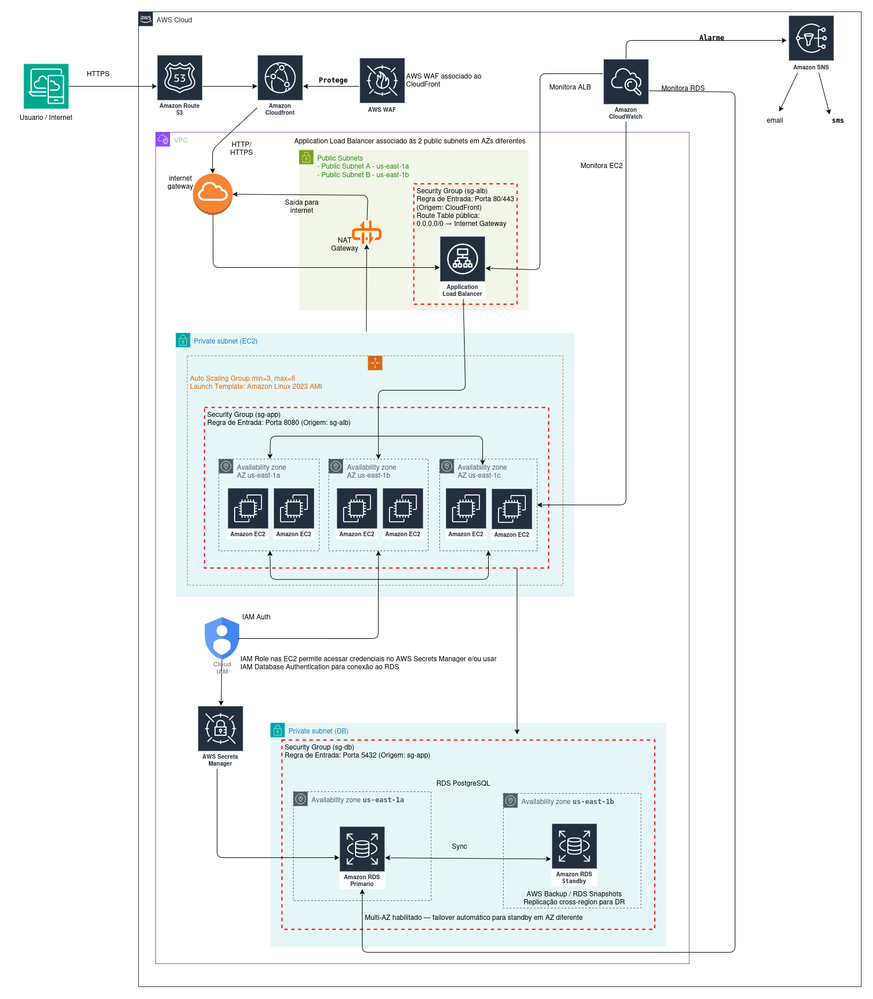

# Estudo de arquitetura AWS — aplicação web escalável

**System Design · Alta disponibilidade · Segurança · Resiliência · Disaster Recovery**

Estudo de uma arquitetura de referência para aplicação web na AWS. O objetivo é avaliar a separação de camadas, estratégias de escalabilidade e tolerância a falhas, e as decisões necessárias para uma operação confiável.

> **Escopo e evidências:** este repositório contém **um desenho de arquitetura e sua análise técnica**. Não há infraestrutura como código, deployment executável, medições de carga, métricas de custo ou evidência de testes de failover. Os componentes descritos representam **uma proposta**, não recursos comprovadamente provisionados.

## Diagrama

- [Editar o diagrama original no Draw.io](diagrama.drawio)
- [Análise crítica e decisões propostas](docs/ARCHITECTURE_REVIEW.md)
- [Plano de validação técnica](docs/VALIDATION_PLAN.md)

## Contexto do problema

Cenário hipotético: uma aplicação web precisa atender requisições HTTP/HTTPS, acomodar variações de demanda, proteger os serviços de aplicação e o banco de dados, e reduzir o impacto de falhas de infraestrutura.

**Requisitos de referência**, ainda não mensurados:

| Requisito | Estratégia proposta | Como comprovar |
| --- | --- | --- |
| Disponibilidade | ALB multi-AZ, EC2 Auto Scaling, RDS Multi-AZ | Exercícios de falha de instância e AZ |
| Escalabilidade | Scaling horizontal de 3 a 6 EC2 (parâmetros do desenho) | Testes de carga e políticas de scaling |
| Segurança | CloudFront + WAF, IAM e Security Groups restritivos | Revisão de políticas e testes de acesso |
| Dados | RDS PostgreSQL primário e standby em outra AZ | Simulação de failover, monitoramento e testes de recuperação |
| Recuperação | Snapshots e proposta de cópia cross-region | Restauração cronometrada e verificação de integridade |
| Operação | CloudWatch, alarmes e notificações SNS | Exercícios de alerta e resposta |

Não foram definidos requisitos numéricos de negócio para disponibilidade, RPO, RTO ou latência. Eles precisam ser negociados e validados antes de dimensionar uma implementação.

## Visão geral da solução

| Camada | Componentes | Responsabilidade |
| --- | --- | --- |
| Edge e DNS | Route 53, CloudFront, AWS WAF | Resolução DNS, entrega/caching e filtragem de requisições |
| Entrada regional | Internet-facing Application Load Balancer | Encaminhar tráfego para instâncias saudáveis |
| Aplicação | EC2 em sub-redes privadas + Auto Scaling Group | Executar a aplicação e ajustar capacidade |
| Dados | RDS PostgreSQL Multi-AZ | Persistência e failover dentro de uma região |
| Rede | VPC, sub-redes, Internet Gateway, NAT Gateway e Security Groups | Separar superfícies públicas e privadas |
| Identidade | IAM Roles e Secrets Manager | Credenciais e permissões controladas |
| Observabilidade | CloudWatch e SNS | Métricas, alarmes e notificações |
| Recuperação | Snapshots e proposta de cópia entre regiões | Possibilitar restauração depois de perda maior |

### Fluxo principal de requisição

1. O cliente resolve o domínio no Route 53 e acessa a distribuição CloudFront via HTTPS.
2. O WAF associado à distribuição avalia a requisição. CloudFront serve conteúdo em cache, quando aplicável, ou encaminha a solicitação para o ALB.
3. O ALB público recebe o tráfego de origem e o distribui para alvos EC2 saudáveis em sub-redes privadas.
4. A aplicação utiliza o RDS PostgreSQL por uma conexão privada, limitada pelo Security Group do banco.
5. Para tráfego **de saída** de instâncias privadas, o desenho considera NAT Gateway; CloudWatch/SNS apoiam a operação e o alerta.

> O WAF é associado à distribuição CloudFront — não é um roteador ou salto físico separado entre CloudFront e ALB. O Internet Gateway fornece conectividade para recursos de sub-redes públicas; ele não realiza o roteamento de aplicação.

## Decisões arquiteturais

**1. ALB público e aplicação privada.** Permite publicar apenas o ponto de entrada e manter EC2/RDS sem endereços públicos. A restrição de acesso à origem precisa de uma configuração explícita — por exemplo, prefix list gerenciada do CloudFront e mecanismo de validação de origem. Veja [revisão de arquitetura](docs/ARCHITECTURE_REVIEW.md).

**2. Escalonamento horizontal.** O desenho sugere um Auto Scaling Group com **mínimo 3 e máximo 6** instâncias. Esses limites não significam seis instâncias permanentes, nem garantem duas em cada AZ. Políticas de escala, health checks, tempo de inicialização e capacidade das sub-redes precisam ser dimensionados.

**3. Alta disponibilidade no banco de dados.** O RDS Multi-AZ oferece standby em outra AZ e failover automático; o standby da configuração tradicional não é uma réplica de leitura. O tempo de failover depende de várias condições e não representa sozinho um RTO contratual.

**4. Separação entre HA e DR.** Multi-AZ é uma estratégia de disponibilidade **dentro da região**; recuperação regional exige mecanismos adicionais, como cópias de backup em outra região, infraestrutura de recuperação e testes de restauração. A simples presença de uma cópia não comprova RTO/RPO.

**5. Custo versus resiliência no NAT.** O desenho original apresenta um NAT Gateway único. Isso pode representar um ponto único de falha para o tráfego de saída de sub-redes em outras AZs. Uma arquitetura de produção geralmente avalia NAT por AZ, rotas locais e VPC endpoints para reduzir dependências e custos.

## Limitações do desenho original

- Foram representadas **EC2 em três AZs**, mas as sub-redes públicas e o ALB estão detalhados em apenas **duas AZs**. Para implantar, é necessário desenhar as sub-redes privadas por AZ e revisar a distribuição/alocação de capacidade.
- O NAT foi desenhado de forma simplificada; não se afirma alta disponibilidade do tráfego de saída.
- O diagrama mostra componentes de segurança/monitoramento, mas não contém configurações executáveis ou evidências de políticas, alarmes, backups ou replicação.
- Não há cálculo de custos, dados de carga, definição de SLO ou demonstração de implantação multi-região.
- O uso de IAM Database Authentication e Secrets Manager são **opções de desenho**; uma implementação deve escolher e documentar o fluxo de credenciais efetivamente utilizado.

## Próximos passos para uma implementação

1. Definir tráfego esperado, regiões, SLOs, RPO/RTO e orçamento.
2. Refinar o desenho de sub-redes, NAT, políticas de roteamento e proteção do ALB.
3. Implementar a arquitetura em Terraform ou AWS CDK com revisão de segurança e custos.
4. Criar uma aplicação mínima e validação automatizada de deploy, escala, indisponibilidade e restauração.
5. Documentar resultados medidos e diferenças em relação ao projeto inicial.

## Referências oficiais

- [AWS — Failover de instância RDS Multi-AZ](https://docs.aws.amazon.com/AmazonRDS/latest/UserGuide/Concepts.MultiAZ.Failover.html)
- [AWS — NAT gateway e resiliência por AZ](https://docs.aws.amazon.com/vpc/latest/userguide/nat-gateway-basics.html)
- [AWS — Restringir acesso ao ALB de origem do CloudFront](https://docs.aws.amazon.com/AmazonCloudFront/latest/DeveloperGuide/restrict-access-to-load-balancer.html)

## Arquivos

- `diagrama.drawio` — fonte editável do desenho original.
- `diagrama-2026-05-03.png` — exportação PNG do desenho original.
- `docs/ARCHITECTURE_REVIEW.md` — trade-offs e pontos de atenção.
- `docs/VALIDATION_PLAN.md` — plano para comprovar requisitos por evidências.

**Natureza do projeto:** exercício de arquitetura e documentação; sem alegação de infraestrutura produtiva.
